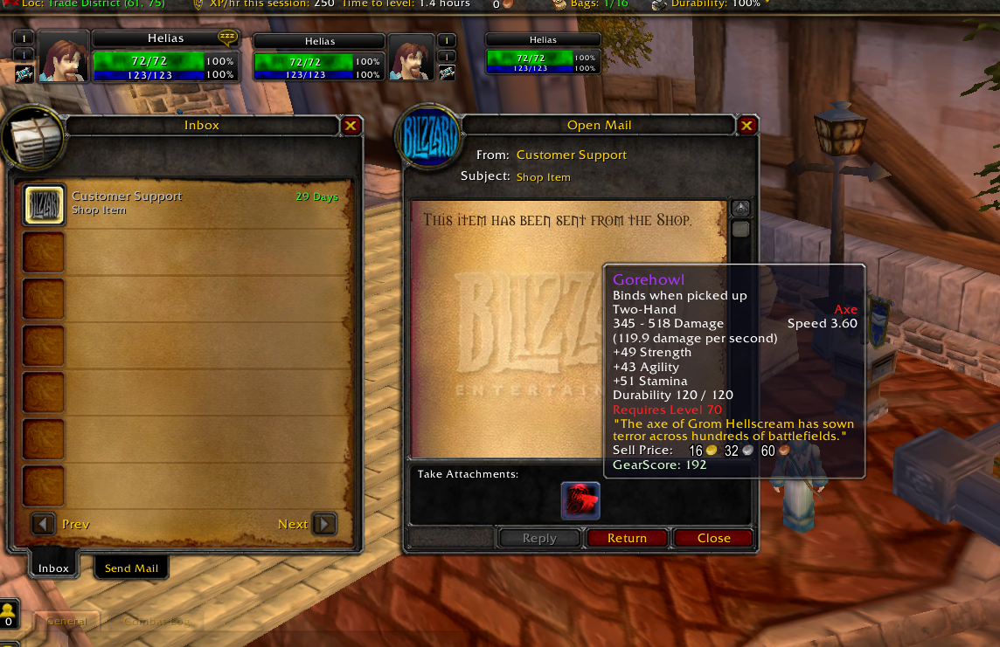
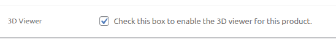
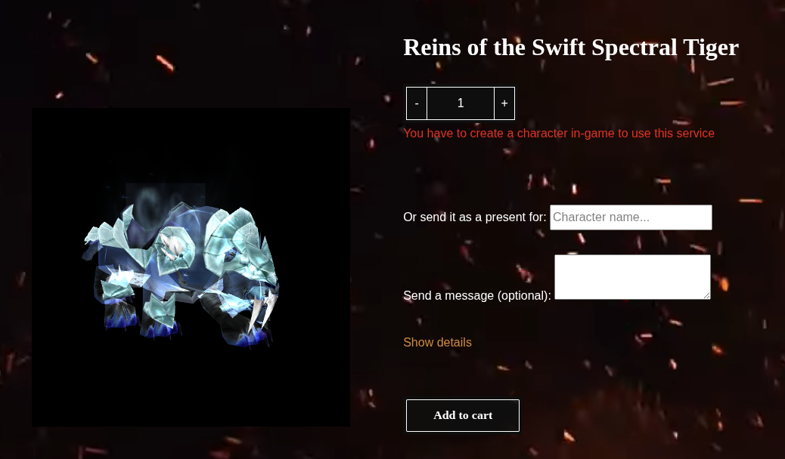
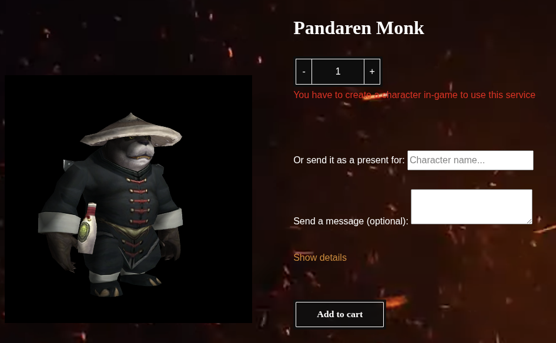
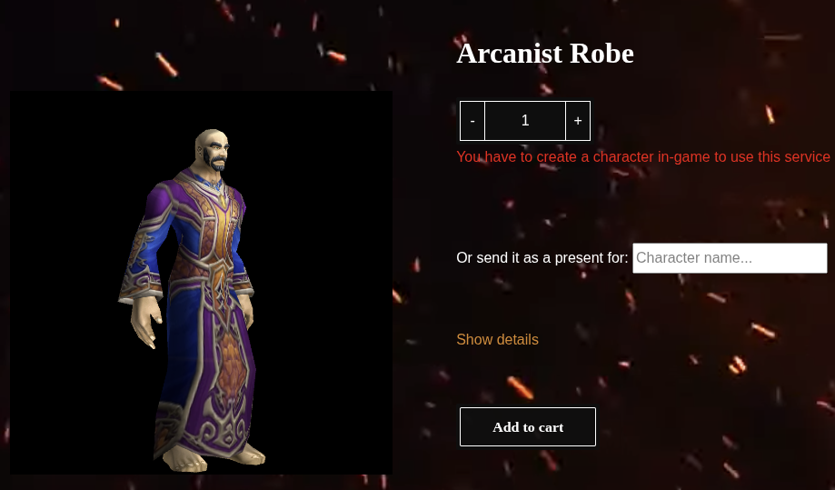

## Configure and connect the CMS webshop to AzerothCore

### Connect the CMS to AzerothCore

#### 1. Enable SOAP in your core
   1. go to the `worldserver.conf` 
   2. change the parameter `SOAP.Enabled` to `1`
   3. use an account with gmlevel 3 in AzerothCore

#### 2. Connect the CMS with your game server
   1. if you use localhost put as `SOAP.IP` your `LOCAL IP`(e.g.: `192.168.x.x` or `0.0.0.0`)
   2. go to the admin panel of the CMS (`localhost/wp-admin/admin.php`)
   3. on `Plugins -> Installed Plugins -> ` activate `AzerothCore Wordpress Integration`
   4. go to `Settings -> Acore Settings Panel`, fill all the fields with the credentials and save (data is pre-filled with some default values, copy those and save)
   5. after saving the settings changes you can verify SOAP using the button `Check SOAP` it should return a similar message `SOAP Response: AzerothCore rev. cbd74ae66365+ 2024-09-09 10:46:15 +0000 (master branch) (Unix, RelWithDebInfo, Static) Connected players: 0. Characters in world: 0. Connection peak: 0. Server uptime: 1 hour(s) 55 minute(s) 35 second(s) Update time diff: 2ms. Last 500 diffs summary: |- Mean: 1ms |- Median: 1ms |- Percentiles (95, 99, max): 2ms, 3ms, 4ms`
   6. if you encounter errors, please see the [Troubleshooting](##Troubleshooting) section below for more details.

**Important:** If the registration fails it can depend on the permissions of your local mysql database, be sure to grant the permission to external connection (like the docker container with wordpress inside can access to the mysql database).

**Important:** Some of the shop elements will not load properly if your database credentials are incorrect, such as the `Add to Cart` button on the product page.


### Register account on the game server

Wordpress by default does not allow the registration from any user, so you first need to enable the registration going to `Settings -> General` and check next to `Membership` the option `Anyone can register`.

Now, when a user will register on your website, after the **verification email process**, the CMS will register an account on the game server.

For the **verification email process** there are several different options:

a. install a **Mail Server** in your webserver (you can find a lot of guides online)  
b. install the plugin **WP SMTP** via `Admin Panle -> Plugins -> Add new` and **[configure it with gmail or other SMTP server](https://www.wpbeginner.com/plugins/how-to-send-email-in-wordpress-using-the-gmail-smtp-server/)**, you just need to have a mail like GMAIL and connect it to WP.  

I recommend you to install the plugin `Manage Notification E-mails` to manage in detail the email sending from your website to the users or to the admins.

If you encounter errors, please see the [Troubleshooting](##Troubleshooting) section below for more details.

### Enable the shop

To add the shop in your website selling items and services you have to:

1. install and configure WooCommerce plugin using `Admin Panel -> Plugins -> Add new` (you can skip the configuration and remove all the shipment options).  
  Now the pages like `Cart, Shop, Checkout` will be created and added into your menu, you can edit them from `Pages`.  
  Remember to set the right currency and manage all the related woocommerce settings.  
  <br>
2. create a product
  - go to `Admin Panel -> Product -> Create new product`
  - set the product as `Virtual`
  - put a price in the `General` section
  - set the SKU as `itemsend_28773` to sell the item 28773 `(Gorehowl)`

3. well, you are selling items but there are no payments method you can install the plugin `WooCommerce PayPal Checkout Payment Gateway` to add PayPal but you can also add other plugins to add more payment method (example: `Woocommerce Stripe Gateway`).  
  After the installation remember to enable `Paypal standard` from `Admin Panel -> Woocommerce -> Settings -> Payments` and enable PayPal standard, later click on `Manage` and add your email to receive the payments.  
  <br>
  4. **(optional)** install the plugin `myCred` to add **"virtual points"** in your website, this will allow you to define a relation between money and your virtual point, so any user can buy items in the shopt through virtual points and buy virtual points with €/$



Besides items you can also sell:

- Guild Rename (using as SKU `guild-rename`), the character must be in a guild and its guild master
- Character Rename (using as SKU `char-change-name`)
- Character Customization (using as SKU `char-change-customize`), includes rename, gender change and face / skin customization
- Change Race (using as SKU `char-change-race`), includes rename and customization, not a faction change. Race / class combinations that no other race of the faction can play can't buy it (e.g. Tauren or Night Elf Druid, Blood Elf Paladin, Draenei Shaman): they are greyed out in the character list, a table shows which races each character could become, and the cart refuses them. The class / race table can be changed with the `acore_char_change_class_races` filter.
- Change Faction (using as SKU `char-change-faction`), includes rename, customization and race change, with the same check for the races of the other faction
- Restore Deleted Characters (using as SKU `char-restore-delete`), this order should be "sold by individually", limiting the purchase 1 item per order.
- Item Restoration (using as SKU `item-restoration`), this allows to restore the item deleted or sold (check `ItemDelete` worldserver conf)
- Carbon Copy tickets (using as SKU `carboncopy-tickets`), this works only if you have the [CarbonCopy lua script](https://github.com/55Honey/Acore_CarbonCopy/).
- Transmog item and itemset (using as SKU `transmog-item_ITEMID` and `transmog-itemset_ITEMSETID`), this works only if you have the [Transmog module](https://github.com/azerothcore/mod-transmog)
- Name Unlock (using as SKU `name-unlock`), this frees up the name of an inactive character and renames the buyer's character to it (the rename is included). How long the name's account must have been inactive depends on the character's level: *AzerothCore -> Tools -> Name Unlock Settings -> Inactivity Thresholds per Level* in the admin panel (a threshold `level, days` applies to characters below that level; by default 30 days below level 5, 90 below 30, 180 below 60, 360 otherwise). Names of accounts with a subscription (Paid Memberships Pro) can't be unlocked.
- SmartStone (using as SKU `smartstone_TYPE_ID`), it requires the [SmartStone module](https://github.com/chromiecraft/mod-chromiecraft-smartstone/). On the product's *Inventory* tab tick **SmartStone product**, pick the type and enter the id: the SKU is built for you (and greyed out) and the product gets the type's sub-category. Types: `0` Companion, `1` Combat pet, `2` Costume (account-wide), `6` Aura, `7` Vehicle, `9` Class perk (account-wide); mounts can't be granted by command. New types can be added with the `acore_smartstone_types` filter.

**Note:** if you want to sell a cumulative item you can use the `SKU itemsend_ITEM-ID_stack`.

**SKUs are case-insensitive:** service SKUs are saved in lowercase (existing products are converted once), and `Smartstone_9_37` works like `smartstone_9_37`. More prefixes can be added with the `acore_service_sku_prefixes` filter.

#### What the buyer sees

- **Character list:** the services that need a character show the account's characters with their race and class icons, name and level. Characters that can't use the service are greyed out, banned characters aren't listed. Without a usable character the product says why and "Add to cart" is disabled.
- **What's included:** Faction Change, Race Change, Customization and Name Unlock say what they include on the product page, in a pop-up when "Add to cart" is pressed ("I understand, add to cart" / "Cancel") and in the cart. The texts can be changed with the `acore_char_change_includes` filter.
- **Cart checks:** a service can only be added to the cart with one of the buyer's own, not banned, characters (and, for a restore, one of the account's deleted characters), and with the fields it needs (a guild for Guild Rename, a name for Name Unlock, a destination account for a transfer).

#### Admin dark mode

The plugin's admin dark mode also covers the WooCommerce screens (products, orders, settings, the product editor).

### 3D Model Viewer

In any product it is possible to enable/disable the 3D viewer via settings on Inventory -> 3D Viewer.



It currently suports:
- mounts/pets/companion under itemsend SKU
- transmog items under transmog-item SKU

Examples:







## Troubleshooting

For everything ask help on [Discord](https://discord.gg/gkt4y2x) in the channel `#acore-cms` (section `TOOLS`), you can also tag @Helias for any issue about this CMS.

---

### Error: could not be connect to the host (during the registration)

Check the SOAP configuration in `worldserver.conf` and into the CMS on `Admin Panel -> Settings -> Acore Settings Panel`.  

To check the SOAP connection between CMS and AzerothCore server you can use the php script from [here](https://stackoverflow.com/questions/59382665/how-to-send-commands-using-soap-to-azerothcore-worldserver-console) or you can use the bash script provided below.

<details>
  <summary>Click to expand and see the bash script with curl</summary>

```bash
#!/bin/bash

# SOAP connection info
SOAP_URI="urn:AC"
SOAP_HOST="localhost"
SOAP_PORT="7878"
ACCOUNT_NAME="admin"
ACCOUNT_PASSWORD="admin"

# SOAP request body template
SOAP_REQUEST="<?xml version=\"1.0\" encoding=\"utf-8\"?>
<SOAP-ENV:Envelope xmlns:SOAP-ENV=\"http://schemas.xmlsoap.org/soap/envelope/\" xmlns:ns1=\"$SOAP_URI\">
    <SOAP-ENV:Body>
        <ns1:executeCommand>
            <command>%s</command>
        </ns1:executeCommand>
    </SOAP-ENV:Body>
</SOAP-ENV:Envelope>"

# Function to perform SOAP request
perform_soap_request() {
    local COMMAND=$1
    local SOAP_BODY=$(printf "$SOAP_REQUEST" "$COMMAND")

    RESPONSE=$(curl -s -X POST "http://$SOAP_HOST:$SOAP_PORT/" \
        -H "Content-Type: text/xml; charset=utf-8" \
        --user "$ACCOUNT_NAME:$ACCOUNT_PASSWORD" \
        -d "$SOAP_BODY")
    
    echo "Response: $RESPONSE"
}

# Call the SOAP request with the desired command
perform_soap_request ".server info"
```
</details> 

---

### Error: SOAP Response: Error 403: HTTP 403 Forbidden

You are probably using an account with gmlevel less than 3, you should upgrade it to 3 with:

```
account set gmlevel USERNAME 3 -1
```

replacing USERNAME with the game account name.

---

### During the registration I get some "PDO errors" OR "Host is not allowed to connect to this mysql"

For both, the problem is probably related to the permissions of the access to your local mysql database.
**How to solve:** edit the mysql permission and create a new user.

Edit the mysql permission of mysql using:

```bash
sudo nano /etc/mysql/mysql.conf.d/mysqld.cnf
```

Change the `bind-address` option into 0.0.0.0 to allow the access from any IPs or just put the specific IP address allowed to connect to the database.

Create a new mysql user, like "acore" with:

```SQL
CREATE USER 'acore'@'localhost' IDENTIFIED BY 'some_pass';
GRANT ALL PRIVILEGES ON *.* TO 'acore'@'localhost' WITH GRANT OPTION;
CREATE USER 'acore'@'%' IDENTIFIED BY 'some_pass';
GRANT ALL PRIVILEGES ON *.* TO 'acore'@'%' WITH GRANT OPTION;
```

Update the configuration into Wordpress `Admin Panel -> Settings -> Acore Settings Panel` with the new user and do not set "localhost" but the LOCAL IP ADDRESS of your machine.
